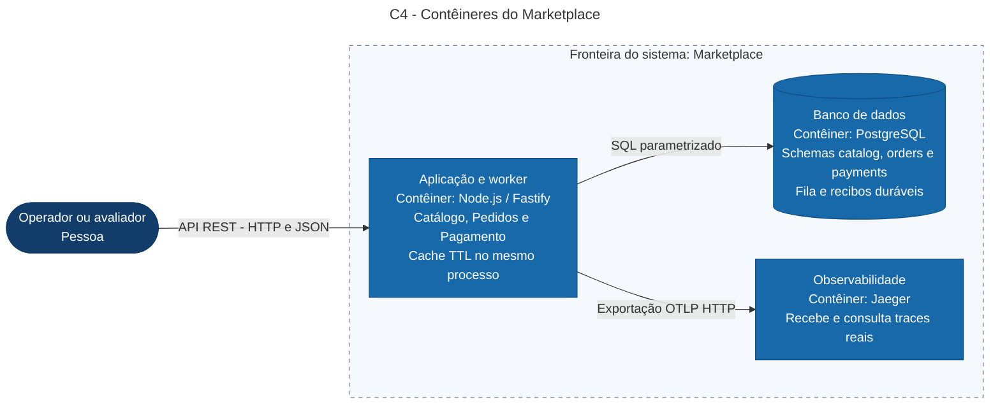

# C4 - Contêiner

Uma única aplicação Node executa os três módulos, cache local e worker. Os schemas catalog/orders/payments compartilham o PostgreSQL, com acesso exclusivo por módulo. A fila e os recibos de idempotência pertencem ao schema payments. Jaeger recebe traces; não processa negócio. Bancos de teste são ambientes de validação, não contêineres permanentes de produção neste desenho.

Fonte correspondente: conteiner.mmd. [PNG renderizado e inspecionado](conteiner.png), com a fronteira do sistema, contêineres e protocolos legíveis. O diagrama usa formas Mermaid flowchart para expressar o nível C4 Contêiner. O deploy de demonstração mantém portas vinculadas a localhost. Memória do cache e armazenamento do Jaeger são transitórios; dados de negócio ficam no volume PostgreSQL. Não há Redis, microsserviços ou fila externa no código atual.
