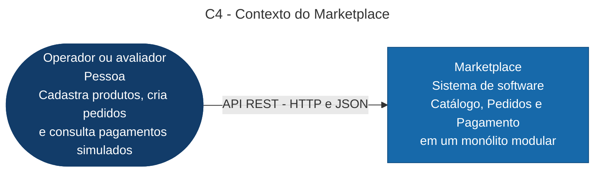

# C4 - Contexto

Escopo: o marketplace é um único sistema. Pagamento é simulado internamente; não existe gateway externo nem cobrança. O operador usa uma API REST, sem frontend no projeto.

Fonte renderizável correspondente: contexto.mmd. [PNG renderizado e inspecionado](contexto.png), sem cortes ou sobreposição de rótulos. O diagrama usa formas Mermaid flowchart para expressar o nível C4 Contexto; não representa implantação. Metadados de geração em ../evidencias/c4-render.json.
